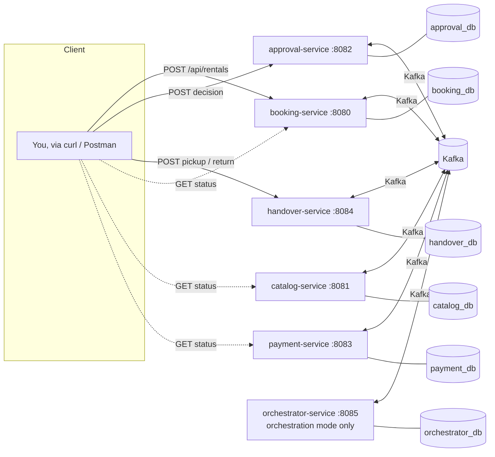
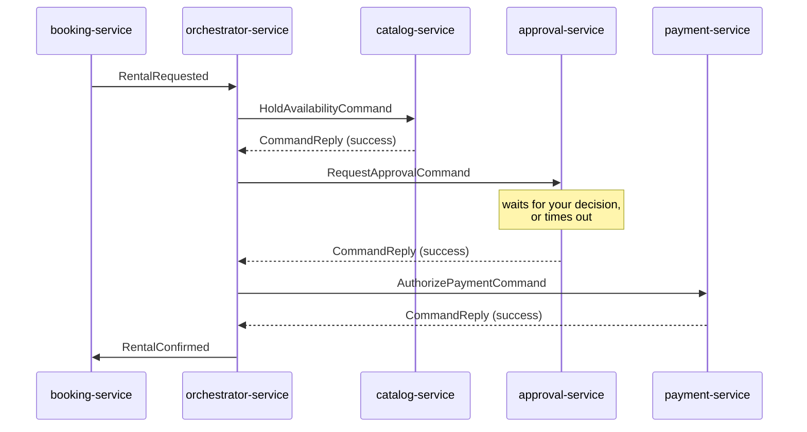
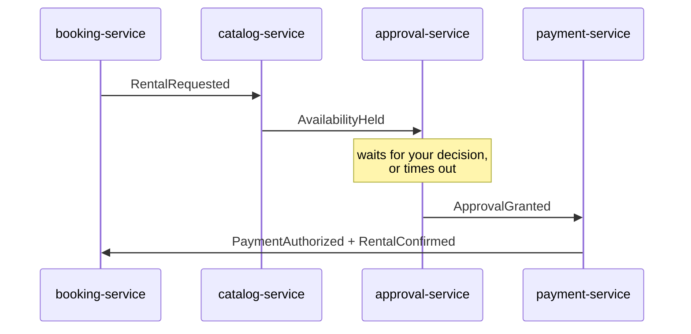
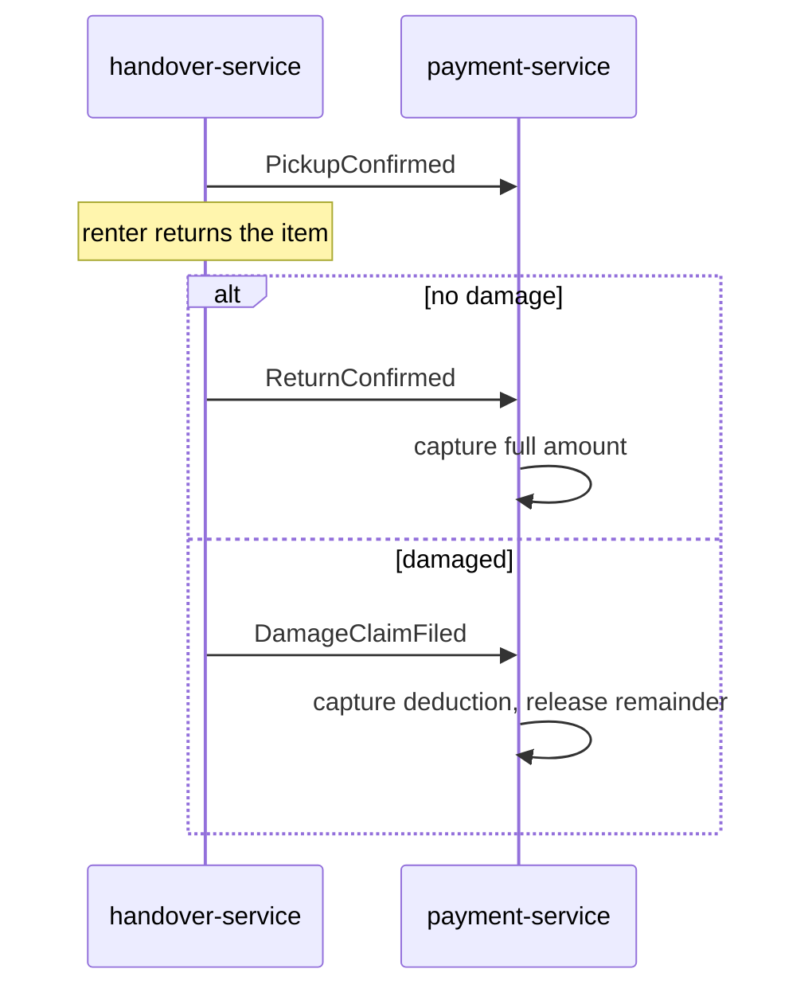

# GearShare -- a saga pattern learning project

GearShare is a peer-to-peer gear rental marketplace (think: renting a camera, a drone, or
a camping tent from another person) built as a set of Spring Boot microservices, entirely
to teach three things at once and show how they fit together:

- **Microservices** -- independent services, each owning its own database.
- **Message-driven architecture** -- every cross-service interaction goes through Kafka,
  never a direct synchronous HTTP call between services.
- **The saga pattern** -- multi-step business processes kept consistent across services
  without a distributed transaction, using either of its two coordination styles.

The distinctive thing about this project: **the same business logic is wired up two
different ways** -- once as an **orchestrated** saga (a dedicated coordinator service
issues explicit commands) and once as a **choreographed** saga (services react to each
other's events directly, with no coordinator). You switch between them with one
environment variable and watch the exact same rental request flow through the system
differently. That comparison is the whole point of the project -- most tutorials only
ever show you one style, which makes it hard to feel the trade-off for yourself.

> **A note on this build.** This project was generated in a sandboxed environment without
> access to Maven Central or a Docker daemon, so it has **not** been compiled or run here
> -- only carefully hand-written and reviewed. `mvn` and `docker compose` both need normal
> internet access, which your own machine will have. If anything doesn't compile, it's
> most likely a small typo; the "Troubleshooting" section at the bottom has pointers.

## Why gear rental, and why these two sagas

A rental has a natural two-act structure, and each act teaches something different:

**Saga #1 -- placing a rental request** (booking -> catalog -> approval -> payment).
Three participants have to agree in sequence, one of them (the owner) is a human who
might never respond, and undoing an already-approved step doesn't reverse anything in
the real world -- it just has to make the bookkeeping honest. This saga is implemented
**both ways** (orchestration and choreography) so you can compare them directly.

**Saga #2 -- fulfillment** (handover reports pickup/return -> payment captures or
partially captures). This is what makes payment holds-vs-captures concrete: saga #1 only
ever *authorizes* a hold, never charges anything. Saga #2 is what turns that hold into
real money, in full or reduced by a damage deduction. It's a short, linear, two-branch
chain, so it's choreographed the same way in both modes -- see "Why saga #2 isn't
orchestrated" below for why that's a deliberate scope decision, not laziness.

## Architecture



Every arrow into Kafka is asynchronous -- no service ever calls another service's REST
API. That's the message-driven half of the lesson: services are coupled to *event and
command shapes* (defined once, in the `common-events` module), never to each other's
network addresses or uptime.

## Saga #1, orchestration mode



One place -- `SagaOrchestrationService` -- holds the entire state machine and decides
what happens next after every reply. If any reply is a failure, the orchestrator walks
**backward** through whatever already succeeded, sending a compensating command for each:
`ReleaseAvailabilityCommand` to catalog, and (uniformly, whether or not it's actually
needed) `CancelApprovalCommand` to approval. The orchestrator also runs a **saga-level
timeout sweep** as a backstop for a participant that never replies at all (e.g.
approval-service's container is down) -- something choreography has no natural place to
put, since there's no central component watching the whole saga's clock.

## Saga #1, choreography mode



No coordinator exists. Each service reacts only to events, chaining forward. On failure,
whichever event signals it (`ApprovalRejected`, `ApprovalTimedOut`, or
`PaymentAuthorizationFailed`) is picked up **independently** by every service that needs
to compensate -- catalog-service releases its hold, and approval-service (on a payment
failure) marks its own record moot, with neither service knowing the other exists. By
convention in this project, **catalog-service** (the first participant) is also the one
that finally publishes `RentalCancelled`, since it's always the last one to finish
unwinding. That convention is a design decision this project made, not an inherent rule
of choreography -- see the code comments in `CatalogEventListener` for the reasoning.

## Saga #2, fulfillment (both modes, always choreographed)



### Why saga #2 isn't orchestrated

Saga #1 has three independent participants, real branching failure modes, and a
human-in-the-loop timeout -- there's a lot for an orchestrator to usefully centralize.
Saga #2 has exactly one participant reacting to exactly one upstream service, in a
straight line. Building an orchestrator for it would just be a coordinator relaying
messages to a single recipient -- extra ceremony with nothing to show for it. Real teams
make this same call constantly: **not every multi-step process needs a saga at all,
let alone an orchestrated one.** Recognizing when coordination overhead isn't worth it is
as much a part of learning this pattern as building it.

## Event & command catalog

All message types live in `common-events`, one topic per type (see `Topics.java`):

| Topic | Payload | Mode |
|---|---|---|
| `rental.requested` | `RentalRequested` | both |
| `rental.confirmed` / `rental.cancelled` | `RentalConfirmed` / `RentalCancelled` | both |
| `catalog.commands.hold` / `.release`, `catalog.replies` | commands + `CommandReply` | orchestration |
| `approval.commands.request` / `.cancel`, `approval.replies` | commands + `CommandReply` | orchestration |
| `payment.commands.authorize` / `.release`, `payment.replies` | commands + `CommandReply` | orchestration |
| `availability.held` / `.rejected` | events | choreography |
| `approval.granted` / `.rejected` / `.timedout` | events | choreography |
| `payment.authorized` / `.authorization-failed` | events | choreography |
| `pickup.confirmed`, `return.confirmed`, `damage.claim.filed` | events | both (saga #2) |
| `payment.captured` / `.partially-captured` | events | both (saga #2) |

## Design notes worth reading the code for

- **Holds vs. captures** (`PaymentSagaService`): saga #1 only ever authorizes; saga #2 is
  what actually moves money. This mirrors how real card processors work for hotels and
  car rentals.
- **Idempotent compensations** (`CatalogSagaService.releaseAvailability`,
  `ApprovalSagaService.markMoot`): every compensating action is safe to call more than
  once, or when there's nothing to undo, because you can never be fully sure a message
  won't be redelivered.
- **The `ApprovalOutcomePublisher` strategy** (`approval-service/messaging`): approval is
  the one participant whose outcome doesn't happen synchronously inside a Kafka listener
  (a human has to act, or time has to pass), so "record the request" and "announce the
  decision" are decoupled, and *where the decision gets announced* is abstracted behind
  an interface with one implementation per mode.
- **Uniform backward compensation** (`SagaOrchestrationService.onPaymentReply`): the
  orchestrator sends `CancelApprovalCommand` even though, in this exact flow, approval
  was already granted and has nothing left to undo. Real orchestrators don't special-case
  that -- they just walk backward and call every compensation, trusting each one to be a
  safe no-op when there's nothing to do.

## Running it

You need Docker and Docker Compose. `SAGA_MODE` is required -- there's no default, on
purpose, so you always know which style you're running.

**Orchestration mode** (starts `orchestrator-service` too):
```bash
SAGA_MODE=orchestration docker compose --profile orchestration up --build
```

**Choreography mode** (no orchestrator container):
```bash
SAGA_MODE=choreography docker compose up --build
```

Give Kafka a few seconds to finish starting; Spring Kafka's consumers retry connecting
automatically, so a service that starts before Kafka is ready will just catch up.

Services and ports: booking `:8080`, catalog `:8081`, approval `:8082`, payment `:8083`,
handover `:8084`, orchestrator `:8085` (orchestration mode only).

## Authentication

booking-service is the system's one public entry point (see "Architecture" above), so
it's the one place authentication was added -- catalog-service, approval-service,
payment-service, and handover-service still have no auth of their own, and neither does
the Kafka traffic between them. That's a deliberate trust-boundary choice, not an
oversight: inside the Docker network, every service-to-service call is already
Kafka-mediated and unreachable from outside it, so the thing actually worth guarding is
the one HTTP door the outside world can knock on. A real deployment would put all of this
behind a proper edge (API gateway, network policy, mTLS between services), but for a
learning project, one JWT-protected entry point demonstrates the same idea at a scale you
can actually read end to end.

booking-service seeds a single demo login the first time it starts against a fresh
database: username `demo`, password `gearshare123` (see `DemoUserSeeder`). Everything
under `/api/rentals` now requires a valid bearer token; `POST /api/auth/login` is the only
endpoint that doesn't.

```bash
# Log in once to get a token (tokens expire after 1 hour by default)
TOKEN=$(curl -s -X POST http://localhost:8080/api/auth/login \
  -H "Content-Type: application/json" \
  -d '{"username":"demo","password":"gearshare123"}' | jq -r .token)

# Use it on every booking-service call from here on
curl http://localhost:8080/api/rentals -H "Authorization: Bearer $TOKEN" | jq
```

An expired or missing token gets a `401`; a well-formed but tampered-with one gets
rejected the same way (see `JwtService.extractUsername` / `.isValid`). Note that
catalog-service's `GET /api/items` and the other services' read endpoints are unaffected
-- they were never behind booking-service's security filter chain to begin with, since
each service's Spring Security config (or absence of one) is entirely its own.

## Walking through the happy path

```bash
# 1. See what's available to rent (catalog-service -- no auth needed)
curl http://localhost:8081/api/items | jq

# 2. Log in to booking-service once and keep the token for every call below
TOKEN=$(curl -s -X POST http://localhost:8080/api/auth/login \
  -H "Content-Type: application/json" \
  -d '{"username":"demo","password":"gearshare123"}' | jq -r .token)

# 3. Request a rental of the camera (item-001)
curl -s -X POST http://localhost:8080/api/rentals \
  -H "Content-Type: application/json" -H "Authorization: Bearer $TOKEN" \
  -d '{"itemId":"item-001","renterId":"renter-jo","ownerId":"owner-amy",
       "startDate":"2026-09-10","endDate":"2026-09-12","totalPrice":90.00}' | jq
# note the "rentalId" in the response

# 4. Watch the request sit PENDING while it waits for owner approval
curl http://localhost:8080/api/rentals/<rentalId> -H "Authorization: Bearer $TOKEN" | jq

# 5. Play the owner: approve it (approval-service -- no auth needed)
curl -s -X POST http://localhost:8082/api/approvals/<rentalId>/decision \
  -H "Content-Type: application/json" -d '{"approved": true}' | jq

# 6. Confirm it went through
curl http://localhost:8080/api/rentals/<rentalId> -H "Authorization: Bearer $TOKEN" | jq  # status: CONFIRMED
curl http://localhost:8081/api/items/item-001 | jq        # available: false
curl http://localhost:8083/api/payments/<rentalId> | jq   # status: AUTHORIZED

# 7. Run saga #2: pick up, then return with no damage (handover-service -- no auth needed)
curl -X POST http://localhost:8084/api/handovers/<rentalId>/pickup
curl -X POST http://localhost:8084/api/handovers/<rentalId>/return \
  -H "Content-Type: application/json" -d '{"damaged": false}'

curl http://localhost:8083/api/payments/<rentalId> | jq   # status: CAPTURED
```

In orchestration mode you can also watch the coordinator's own view of things:
`curl http://localhost:8085/api/sagas/<rentalId> | jq`.

## Things to try (each one exercises a different saga path)

- **First-step rejection, no compensation needed** -- request `item-005` (seeded
  permanently unavailable). `catalog.replies`/`AvailabilityRejected` fails immediately and
  the saga is cancelled without ever reaching approval or payment.
- **Owner declines** -- POST `{"approved": false}` to the decision endpoint. Watch
  catalog's hold get released and the item become available again.
- **Owner never answers** -- just don't call the decision endpoint. After
  `approval.timeout-seconds` (60s by default) the scheduled sweep times it out and the
  saga unwinds the same way as an explicit decline.
- **Payment declined, full backward compensation** -- use `renterId: "renter-blocked"`.
  Both the availability hold AND the (already-granted!) approval get compensated -- in
  orchestration mode, watch `CancelApprovalCommand` fire even though there's nothing
  really left to undo.
- **Approval-service goes dark** (orchestration mode only) -- start a rental, then
  `docker compose stop approval-service` before deciding. After
  `orchestrator.saga-timeout-seconds` (90s) the orchestrator's backstop sweep compensates
  the saga on its own, distinct from approval-service's own per-request timeout.
- **Damaged return** -- run the happy path through pickup, then
  `POST /return {"damaged": true, "deductionAmount": 15.00, "description": "scratched lens"}`
  and watch payment go to `PARTIALLY_CAPTURED` with the remainder released.

## Extending it

A few natural next steps if you want to keep building on this:

- Swap `ddl-auto: update` for Flyway or Liquibase migrations (the deliberate corner cut
  for a learning project -- fine here, not fine in production).
- Add a fourth saga #1 step (e.g. a `ConfirmShippingCommand`) to see
  `ReleasePaymentCommand` -- currently defined but unused, since payment is the last step
  -- finally get exercised as a real compensation.
- Add an outbox table to each participant so publishing to Kafka and writing to Postgres
  become atomic (right now, in the rare case a service crashes between the two, a
  message could be lost -- the classic "dual write" problem sagas don't solve by
  themselves).
- Containerize a small Kafka UI (e.g. `provectuslabs/kafka-ui`) to *watch* the topics
  fill up in real time instead of only inferring what happened from service logs.

## Troubleshooting

- **A service can't reach Postgres/Kafka on startup** -- normal on the very first `up`;
  Spring Kafka and the JPA connection pool both retry. Re-run `docker compose up` if a
  container exits before the others finish starting.
- **`mvn` can't resolve `com.gearshare:common-events`** -- run
  `mvn -pl common-events -am install` once locally before building an individual
  service's Dockerfile in isolation; `docker compose build` already handles this itself
  via the Maven reactor (`-am`), so this only matters if you're running `mvn` by hand
  outside Docker.
- **Kafka container fails to start** -- the `apache/kafka` image's KRaft bootstrap is
  sensitive to a stale `CLUSTER_ID` if you previously ran a different Kafka image against
  the same named volume; this project doesn't volume-mount Kafka's own data, so a
  `docker compose down` and `up` again should always start clean.
